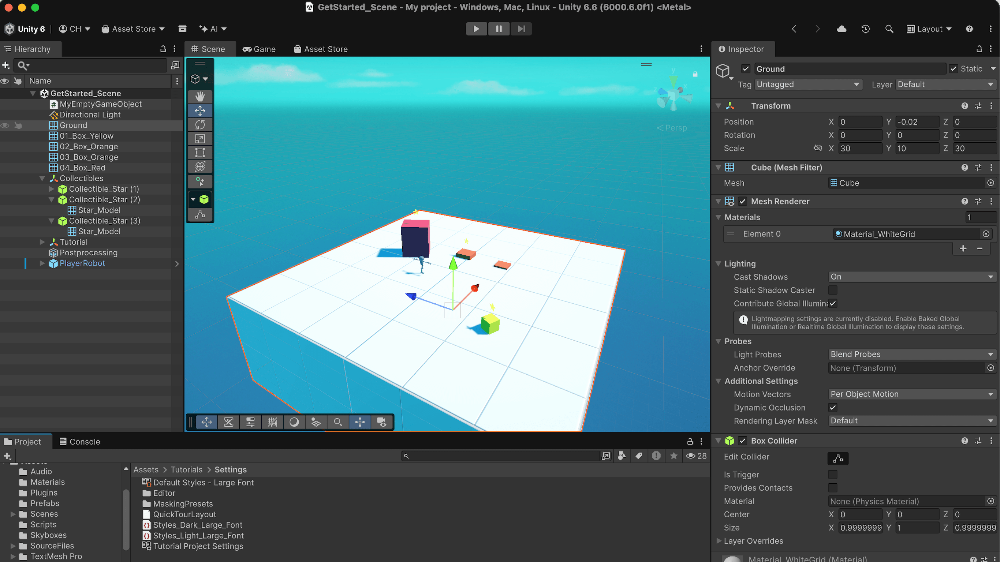

# How to Use Feature Flags in Unity Sample Project

**[Read the blog post here](https://configcat.com/blog/using-feature-flags-in-unity)**

This sample Unity project demonstrates how to use feature flags in Unity with C# and ConfigCat's .NET SDK. In this project, a feature flag controls a robot's ability to jump onto boxes automatically.

## Build & Run

### Prerequisites

- A computer that meets the [system requirements for Unity](https://docs.unity.com/en-us/engine/6000.6/manual/get-started/install-and-upgrade/getting-started-installing-unity/system-requirements#desktop).
- [Unity Hub](https://unity.com/download) and the Unity 6 Editor installed.
- [Visual Studio Code](https://code.visualstudio.com/) with the [C# Dev Kit](https://marketplace.visualstudio.com/items?itemName=ms-dotnettools.csdevkit) and [Unity](https://code.visualstudio.com/docs/other/unity) extensions installed.
- The [Microsoft .NET SDK](https://dotnet.microsoft.com/en-us/download/) installed.
- The [ConfigCat .NET SDK version 10.0.0](https://www.nuget.org/packages/ConfigCat.Client/10.0.0).
- [Git](https://git-scm.com/downloads) installed to clone this sample project.

### Building and running the project

1. Clone this sample project.

    ```bash
    git clone https://github.com/configcat-labs/feature-flags-in-unity-sample.git
    ```

2. Launch the project in Unity.

    

3. Add your ConfigCat SDK Key to `Assets/Scripts/SingletonServices.cs`, and your feature flag key to `Assets/Scripts/AutoJumpOnBoxes.cs`. Then, toggle the feature flag ON and OFF in your [ConfigCat Dashboard](https://app.configcat.com) to toggle the robot's jump behavior. 

  

## Learn more

Useful links to technical resources.

- [Unity Documentation](https://docs.unity.com/en-us)
- [ConfigCat .NET SDK documentation](https://configcat.com/docs/sdk-reference/dotnet/)
- [Using the ConfigCat SDK in Unity documentation](https://configcat.com/docs/sdk-reference/unity/)

[**ConfigCat**](https://configcat.com) supports many other frameworks and languages. Check out the full list of supported SDKs [here](https://configcat.com/docs/sdk-reference/overview/).

You can also explore other code samples for various languages, frameworks, and topics in [ConfigCat labs](https://github.com/configcat-labs) on GitHub.

Keep up with ConfigCat on [X](https://x.com/configcat), [Facebook](https://www.facebook.com/configcat), [LinkedIn](https://www.linkedin.com/company/configcat/), [GitHub](https://github.com/configcat), and the [News & Product Updates](https://configcat.com/docs/news/) page.

## Author

[Chavez Harris](https://github.com/codedbychavez)

## Contributions

Contributions are welcome!